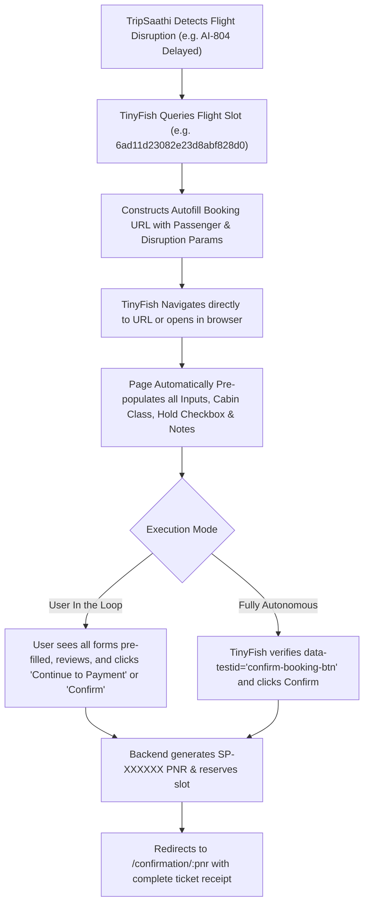

# SkyPulse Airlines Autofill Booking Link Integration Guide
**Autonomous Agent (TinyFish / TripSaathi) Seamless Flight Slot Reservation & Autofill**

---

## 1. Overview & Objectives

In airline disruption recovery scenarios (e.g. flight delays or cancellations handled by **TripSaathi**), an autonomous agent like **TinyFish** must reserve a flight slot or rebook an affected passenger quickly without manual form entry or brittle DOM input simulations.

To achieve this, SkyPulse Airlines provides a **Parameterized Autofill Booking Route**:
- Any agent or user can navigate directly to:
  ```text
  https://sky-airlines.vercel.app/book/<FLIGHT_BOOKING_ID>?<QUERY_PARAMETERS>
  ```
  Example:
  ```text
  https://sky-airlines.vercel.app/book/6ad11d23082e23d8abf828d0?name=Rahul+Sharma&email=rahul@example.com&phone=%2B919876543210&flight=AI-804&arrival=late&hold=true&payment=pay_at_property
  ```
- All passenger details, cabin class, flight disruption references, arrival windows, guaranteed seat hold requests, and payment modes are extracted from URL query parameters and pre-populated into the form automatically.
- A **"Smart Autofill Active — TinyFish / TripSaathi Linked"** visual notification banner confirms that fields were loaded from the autonomous link.
- **1-Click User or Agent Finalization**:
  - TinyFish can pre-fill the entire form and open the website for the user to just click **"Continue to Payment"** (`data-testid="continue-to-payment-button"`).
  - Or with `step=2` or `payment=pay_at_property`, finalize in **1 action** via **"Confirm Reservation (₹0 Due Today)"** (`data-testid="confirm-booking-btn"`).

---

## 2. URL Specification & Format

### Base URL Structure
```text
https://sky-airlines.vercel.app/book/<FLIGHT_BOOKING_ID>?<QUERY_PARAMETERS>
```

- **Production:** `https://sky-airlines.vercel.app/book/6ad11d23082e23d8abf828d0?...`
- **Local Dev:** `http://localhost:5000/book/6ad11d23082e23d8abf828d0?...`

The `<FLIGHT_BOOKING_ID>` in the route path is the 24-character hexadecimal MongoDB ObjectId representing the flight slot (e.g., `6ad11d23082e23d8abf828d0`), or any valid flight code (e.g., `AI-805`, `SP-804`).

---

## 3. Query Parameters Reference

The system supports standard parameter keys along with convenient aliases matching the **StayPulse** autonomous agent specification:

| Parameter | Aliases | Type | Example Value | Description & Behavior |
| :--- | :--- | :--- | :--- | :--- |
| `name` | `passenger_name`, `guest_name`, `traveler_name`, `full_name` | string | `Rahul Sharma` | Pre-populates the Full Passenger Name field. |
| `email` | `passenger_email`, `guest_email`, `traveler_email` | string | `rahul@example.com` | Pre-populates the Email Address for ticket and PNR delivery. |
| `phone` | `passenger_phone`, `guest_phone`, `contact`, `mobile`, `tel` | string | `%2B919876543210` | Pre-populates Contact Phone (use `%2B` or `+` for country code). |
| `age` | `passenger_age`, `traveler_age` | integer | `28` | Pre-populates Passenger Age (1–120). |
| `gender` | `passenger_gender`, `sex` | string | `Male` | Intelligently resolves `Male`, `Female`, or `Other` (`m`/`f`/`o`). |
| `class` | `cabin`, `cabin_class`, `seat_class`, `tier` | string | `Economy` or `Business` | Automatically selects cabin tier. Matches `biz`/`business` $\to$ Business, `eco`/`economy` $\to$ Economy. |
| `flight` | `flight_delay`, `disrupted_flight`, `delayed_flight` | string | `AI-804` | Auto-generates disruption notice: `"Holding check-in due to flight delay AI-804 arriving late"`. |
| `arrival` | `arrival_time`, `expected_arrival` | string | `late` or `20:00` | Appends late transit/arrival context to the disruption hold notice. |
| `hold` | `late_hold`, `seat_hold`, `fare_lock` | boolean | `true` or `1` | Toggles the checkbox: *"Request Guaranteed Disruption Check-in Hold until departure"*. |
| `payment` | `payment_mode`, `pay` | string | `pay_at_property` or `online` | Selects either **Pay at Airport Desk / Disruption Voucher** (₹0 upfront, reserved instantly) or **Online Razorpay**. |
| `step` | `auto_step`, `stage`, `screen` | string / int | `1` or `2` (or `payment`) | Sets checkout step. `step=2` advances directly to Payment & Confirmation screen. |
| `date` | `flight_date`, `dep_date`, `departure_date` | string (YYYY-MM-DD) | `2026-10-22` | Overrides departure date displayed on the itinerary card. |
| `notes` | `special_requests`, `request` | string | `Wheelchair assistance requested` | Custom requests sent to airline. Overrides default flight disruption notice if set. |

---

## 4. Live Examples

### Example 1: Full Disruption Recovery (Flight Delay + Pay at Airport Desk / ₹0 Upfront)
```text
https://sky-airlines.vercel.app/book/6ad11d23082e23d8abf828d0?name=Rahul+Sharma&email=rahul%40example.com&phone=%2B919876543210&flight=AI-804&arrival=late&hold=true&payment=pay_at_property
```

**Result upon loading:**
- **Flight**: Air India AI-805 (`DEL` New Delhi $\to$ `BOM` Mumbai, 07:00 $\to$ 09:15)
- **Primary Passenger Name**: `Rahul Sharma`
- **Email Address**: `rahul@example.com`
- **Phone Number**: `+91 9876543210`
- **Cabin Class**: `Economy Class`
- **Disruption Notice**: `Holding check-in due to flight delay AI-804 arriving late`
- **Guaranteed Hold**: Checked (`true`) — *"Request Guaranteed Disruption Check-in Hold until departure"*
- **Payment Method**: `Pay at Airport Desk (₹0 Due Today)`
- **Banner**: Displays *"Smart Autofill Active — TinyFish / TripSaathi Linked"*

---

### Example 2: Minimal Parameters (Auto-generates fallbacks)
```text
https://sky-airlines.vercel.app/book/6ad11d23082e23d8abf828d0?name=Priya+Patel&email=priya%40test.com&phone=%2B919876543210&flight=6E-205
```

---

### Example 3: Advance Directly to Step 2 (1-Click Instant Checkout)
```text
https://sky-airlines.vercel.app/book/6ad11d23082e23d8abf828d0?name=Rahul+Sharma&email=rahul%40example.com&phone=%2B919876543210&flight=AI-804&arrival=late&hold=true&payment=pay_at_property&step=2
```
**Result upon loading:**
- The page opens directly on **Step 2 (Review & Select Payment Method)**.
- Passenger details and disruption note are already summarized.
- Payment mode is set to **Pay at Airport Desk (₹0 Due Today)**.
- TinyFish or the user only needs **1 click** on `[Confirm Reservation (₹0 Due Today)]` (`data-testid="confirm-booking-btn"`).

---

## 5. TinyFish Automation Selectors Guide

TinyFish agents can easily target the booking page using stable `data-testid` attributes (with full backward-compatible aliases matching StayPulse):

| Element | Selector / Test ID | Aliases Supported |
| :--- | :--- | :--- |
| Passenger Name Input | `[data-testid="passenger-name-input"]` | `[data-testid="guest-name-input"]` |
| Passenger Email Input | `[data-testid="passenger-email-input"]` | `[data-testid="guest-email-input"]` |
| Passenger Phone Input | `[data-testid="passenger-phone-input"]` | `[data-testid="guest-phone-input"]` |
| Passenger Age Input | `[data-testid="passenger-age-input"]` | `input[name="passenger_age"]` |
| Passenger Gender Select | `[data-testid="passenger-gender-select"]` | `select` |
| Cabin Economy Button | `[data-testid="cabin-class-economy-btn"]` | |
| Cabin Business Button | `[data-testid="cabin-class-business-btn"]` | |
| Disruption Notes / Requests | `[data-testid="special-requests-input"]` | `input[placeholder*="Holding check-in"]` |
| Guaranteed Seat Hold Checkbox | `[data-testid="seat-hold-checkbox"]` | `[data-testid="late-hold-checkbox"]` |
| **Continue to Payment Button** | `[data-testid="continue-to-payment-button"]` | `#continue-booking-btn` |
| Pay at Airport Desk Option | `[data-testid="payment-method-pay-at-property"]` | `[data-testid="payment-method-sandbox"]` |
| Online Razorpay Option | `[data-testid="payment-method-razorpay"]` | |
| **Confirm Reservation Button** | `[data-testid="confirm-booking-btn"]` | `#confirm-booking-btn` |
| Smart Autofill Banner | `[data-testid="autofill-banner"]` | |
| Copy Autofill URL Button | `[data-testid="copy-autofill-btn"]` | `[data-testid="share-autofill-btn-header"]` |

---

## 6. TinyFish Crawling / Autonomous Booking Workflow



---

## 7. How to Use in Your TinyFish App

### Step 1: TinyFish Gathers Passenger & Disrupted Flight Info
TinyFish collects:
- Passenger details: `name`, `email`, `phone`, `age`, `gender`
- Disrupted flight code: `flight=AI-804`
- Recovery preferences: `class=Economy`, `hold=true`, `payment=pay_at_property`

### Step 2: TinyFish Constructs the Target URL
```javascript
const flightBookingId = "6ad11d23082e23d8abf828d0"; // Flight slot ObjectId
const params = new URLSearchParams({
  name: "Rahul Sharma",
  email: "rahul@example.com",
  phone: "+919876543210",
  flight: "AI-804",
  arrival: "late",
  hold: "true",
  payment: "pay_at_property",
});

const autofillUrl = `https://sky-airlines.vercel.app/book/${flightBookingId}?${params.toString()}`;
```

### Step 3: TinyFish Opens the Website
TinyFish opens the browser or presents the link to the user:
```text
https://sky-airlines.vercel.app/book/6ad11d23082e23d8abf828d0?name=Rahul+Sharma&email=rahul%40example.com&phone=%2B919876543210&flight=AI-804&arrival=late&hold=true&payment=pay_at_property
```
All fields are auto-filled instantly. The user (or TinyFish) only needs to click **"Continue to Payment"** or **"Confirm Reservation"**!
